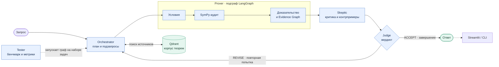

# Agentic Truth

**Доказательства под проверкой.** Мультиагентная система для задач математического анализа: ищет релевантные теоремы, строит доказательство, проверяет вычисления и ищет контрпримеры прежде, чем выдать ответ.

`LangGraph` · `GigaChat` · `Qdrant` · `SymPy` · `Streamlit`

## Как это устроено

Основной процесс реализован как граф состояний **LangGraph** в [`main.py`](main.py). Узлы обмениваются общим состоянием из [`core/state.py`](core/state.py); **Prover** подключён к основному графу как отдельный подграф. **Tester** запускает сквозные проверки графа отдельно, а не участвует в обработке каждого запроса.

| Агент | Роль |
| --- | --- |
| **Orchestrator** (`agents/orchestrator/`) | Классифицирует запрос, формирует гипотезы и подзапросы; получает контекст через multi-query RAG из Qdrant. |
| **Prover** (`agents/prover/`) | Декомпозирует условия, проверяет символьные шаги через SymPy, синтезирует доказательство и граф обоснования (Evidence Graph). |
| **Skeptic** (`agents/skeptic/`) | Проверяет слабые места рассуждения и граничные условия, предлагает контрпримеры из каталога. |
| **Judge** (`agents/judge/`) | Сопоставляет доказательство, источники и замечания Skeptic; принимает ответ или направляет его на повторную итерацию. |
| **Tester** (`agents/tester/`) | Прогоняет набор задач через готовый граф, считает метрики и формирует отчёт. |



**Технологии.** GigaChat служит языковым бэкендом агентов; без `GIGACHAT_CREDENTIALS` предусмотрены локальные аналитические fallback-сценарии для демонстрации и тестов. Qdrant работает в локальном embedded-режиме (`qdrant_db/`), индексируя корпус из `rag/`; для поиска используются символьные TF-IDF-векторы. SymPy используется в модуле `tools/sympy_verifier.py` для проверки подходящих символьных вычислений. Такой аудит не заменяет полного формального доказательства.

## Быстрый старт

Нужен Python и доступ к пакетам из [`requirements.txt`](requirements.txt). Из корня проекта:

**Linux / macOS**

```bash
python3 -m venv .venv
source .venv/bin/activate
python -m pip install -r requirements.txt
cp .env.example .env
```

**Windows (PowerShell)**

```powershell
python -m venv .venv
.\.venv\Scripts\Activate.ps1
python -m pip install -r requirements.txt
Copy-Item .env.example .env
```

Откройте `.env` и укажите параметры GigaChat (не публикуйте файл и ключи):

```dotenv
GIGACHAT_CREDENTIALS=<ваш_ключ_авторизации>
GIGACHAT_SCOPE=GIGACHAT_API_PERS
GIGACHAT_MODEL=GigaChat
TAVILY_API_KEY=
```

`GIGACHAT_CREDENTIALS` — ключ авторизации в формате, ожидаемом клиентом GigaChat. Клиенту всегда передаётся `scope="GIGACHAT_API_PERS"` (значение `GIGACHAT_SCOPE` из `.env` сейчас не используется); укажите нужную модель в `GIGACHAT_MODEL`. `TAVILY_API_KEY` нужен только для функций, использующих веб-поиск. Для локального запуска без GigaChat оставьте `GIGACHAT_CREDENTIALS` пустым: тогда используются предусмотренные в коде fallback-механизмы. `.env` исключён из Git через `.gitignore`.

После активации окружения запустите интерфейс или консольный пример:

```bash
streamlit run app.py
# либо:
python main.py
```

В Linux / macOS для интерфейса также доступен `./run.sh`. Streamlit обычно открывается по адресу `http://localhost:8501`. Локальный индекс Qdrant создаётся при первом обращении к базе; отдельный сервер Qdrant не нужен.

## Проверка

```bash
python -m unittest discover -s tests -v
```

Для сквозного бенчмарка откройте соответствующую вкладку в Streamlit: [`agents/tester/`](agents/tester/) содержит набор задач, вычисление метрик и генерацию отчёта.

## Структура

```text
main.py               сборка и запуск графа LangGraph
app.py                веб-интерфейс Streamlit
agents/               Orchestrator, Prover, Skeptic, Judge, Tester
core/                 состояние графа, конфигурация, клиент GigaChat
rag/                  корпус, retrieval и локальное хранилище Qdrant
tools/                проверка символьных шагов через SymPy
tests/                автоматические тесты
.env.example          шаблон переменных окружения
```
