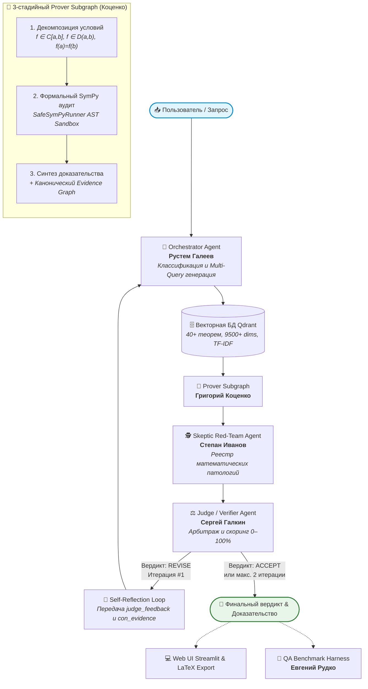

# 🧮 Agentic Truth: Мультиагентная Верификация Математического Анализа

[](https://github.com/rustemgotop-beep/agentic-truth/actions/workflows/tests.yml)
[](https://github.com/rustemgotop-beep/agentic-truth)
[](https://www.python.org/)
[](https://qdrant.tech/)
[](https://www.sympy.org/)
[-green.svg)](https://developers.sber.ru/portal/products/gigachat)
[](https://github.com/rustemgotop-beep/agentic-truth)
[](LICENSE)

> **Курсовой проект Команды № 14 (КП1 / КП2 / КП3)**  
> Распределенная мультиагентная система строгой верификации математических доказательств, Citation-First Multi-Query RAG на базе **Qdrant**, формального символьного аудита **SymPy AST**, Red-Team проверки контрпримерами и арбитража с петлей рефлексии (Self-Reflection Loop) на базе **LangGraph** и **GigaChat**.

---

## 🎯 Проблема и Миссия Проекта

Современные большие языковые модели (LLM) при доказательстве строгих математических теорем страдают от двух фундаментальных проблем:
1. **Галлюцинации граничных условий**: модель интуитивно «помнит» ход доказательства, но упускает критические предпосылки (например, различие между компактностью отрезка $[a, b]$ и открытостью интервала $(a, b)$, дифференцируемостью функции или связностью области).
2. **Отсутствие формальной проверяемости**: текст доказательства выглядит убедительно, но логические переходы и алгебраические преобразования не верифицируются детерминированным символьным ядром.

**Agentic Truth** решает эту проблему через **ортогональное разделение ролей 5 специализированных агентов** с формальной верификацией каждого шага в SymPy, поиском первоисточников в локальной векторной базе Qdrant и построением канонического **Evidence Graph** (графа обоснования по Разделу 6 ТЗ).

---

## 👥 Роли участников команды и Clean Architecture

Проект спроектирован по стандарту **Clean Architecture**: у каждого участника команды выделен собственный изолированный модуль в каталоге `agents/` с собственными промптами, логикой и детерминированными аналитическими фоллбэками:

| Роль | Участник | Модуль | Ключевая ответственность |
| :--- | :--- | :--- | :--- |
| **Member 1: Orchestrator Lead** | **Рустем Галеев** | [`agents/orchestrator/`](file:///Users/grigoriy/PycharmProjects/agentic-truth/agents/orchestrator/) | Классификация задач (`prove_theorem`, `find_counterexample`, `verify_identity`), декомпозиция на 3 подзапроса, Multi-Query поиск в Qdrant с дедупликацией. |
| **Member 2: Prover Agent** | **Григорий Коценко** | [`agents/prover/`](file:///Users/grigoriy/PycharmProjects/agentic-truth/agents/prover/) | 3-стадийный Prover Subgraph (Декомпозиция предпосылок $\to$ формальный SymPy AST аудит $\to$ синтез доказательства), построение Evidence Graph, экспорт в компилируемый LaTeX. |
| **Member 3: Skeptic Agent** | **Степан Иванов** | [`agents/skeptic/`](file:///Users/grigoriy/PycharmProjects/agentic-truth/agents/skeptic/) | Red-Team аудит логических брешей (Gaps) и подбор патологических контрпримеров ($f(x)=\|x\|$, $\operatorname{sgn}(x)$, $1/x$, функция Пеано — Шварца). |
| **Member 4: Judge Agent** | **Сергей Галкин** | [`agents/judge/`](file:///Users/grigoriy/PycharmProjects/agentic-truth/agents/judge/) | Интеллектуальный арбитраж, скоринг уверенности (0–100%), условный роутер петли рефлексии (`ACCEPT` / `REVISE`) с лимитом 2 итераций по ТЗ. |
| **Member 5: QA Lead** | **Евгений Рудко** | [`agents/tester/`](file:///Users/grigoriy/PycharmProjects/agentic-truth/agents/tester/) | Автоматизированный стенд тестирования (Evaluation Harness), золотой датасет бенчмарков, замер задержки (Latency), SymPy Verification Rate и Groundedness Rate. |

---

## 🔄 Архитектура и граф взаимодействия агентов



---

## 🏛 Структура репозитория

```text
agentic-truth/
├── .github/workflows/          # Автоматический CI/CD (GitHub Actions)
│   └── tests.yml               # Прогон 21 теста и бенчмарка QA на Python 3.10 и 3.11
├── .gitignore                  # Игнорирование .venv, .env, __pycache__, артефактов
├── .env.example                # Шаблон конфигурации для GigaChat и Tavily
├── requirements.txt            # Фиксированные зависимости (LangGraph, GigaChat, SymPy, Qdrant)
├── README.md                   # Академическая документация проекта
├── demo.ipynb                  # Интерактивный демонстрационный Jupyter Notebook
│
├── core/                       # Ядро системы
│   ├── state.py                # Общий контракт состояния графа (State TypedDict)
│   ├── llm.py                  # Фабрика моделей: СТРОГО GigaChat (Сбер) + офлайн-фоллбэки
│   └── config.py               # Конфигурационные параметры и безопасное чтение .env
│
├── tools/                      # Инструменты формальной математики
│   └── sympy_verifier.py       # Безопасная AST-песочница SafeSymPyRunner (без eval-уязвимостей)
│
├── rag/                        # Векторная база знаний Qdrant и ретривер
│   ├── qdrant_store.py         # Локальное хранилище Qdrant (Embedded, TF-IDF 3-5 n-grams, 9500+ dims)
│   ├── retriever.py            # Поисковый слой (Multi-Query Qdrant + дедупликация)
│   └── corpus.py               # Академический мини-корпус (Зорич, Фихтенгольц, Кудрявцев)
│
├── agents/                     # Модульная Clean Architecture (все 5 ролей команды)
│   ├── orchestrator/           # 🎯 [ORCHESTRATOR] Рустем Галеев
│   │   ├── agent.py            # Узел orchestrator_node, классификация задач, генерация подзапросов
│   │   ├── prompts.py          # Промпты планирования и декомпозиции
│   │   └── __init__.py         # Чистый экспорт orchestrator_node
│   ├── prover/                 # 📐 [PROVER AGENT] Григорий Коценко
│   │   ├── agent.py            # 3-стадийный Prover Subgraph + генерация Evidence Graph
│   │   ├── prompts.py          # Академические промпты для GigaChat (LaTeX, цитаты)
│   │   └── __init__.py         # Экспорт prover_subgraph и prover_node
│   ├── skeptic/                # 🕵️ [SKEPTIC AGENT] Степан Иванов
│   │   ├── agent.py            # Узел skeptic_node, аудит краевых условий и поиск брешей
│   │   ├── catalog.py          # Реестр патологических контрпримеров (|x|, sgn, 1/x, Пеано-Шварц...)
│   │   ├── prompts.py          # Промпты поиска контрпримеров
│   │   └── __init__.py         # Экспорт skeptic_node, get_catalog_counterexample
│   ├── judge/                  # ⚖️ [JUDGE AGENT] Сергей Галкин
│   │   ├── agent.py            # Узел judge_node, скоринг доверия и арбитраж
│   │   ├── prompts.py          # Промпты вердикта (ACCEPT/REVISE)
│   │   └── __init__.py         # Экспорт judge_node и judge_router
│   ├── tester/                 # 🧪 [QA LEAD] Евгений Рудко
│   │   ├── agent.py            # Класс TesterAgent для управления оценкой
│   │   ├── benchmark.py        # Сквозной раннер бенчмарков с замером Latency и SymPy Rate
│   │   ├── dataset.py          # Золотой набор академических кейсов (BENCHMARK_CASES)
│   │   ├── metrics.py          # Расчет метрик качества и генерация отчета
│   │   └── __init__.py         # Экспорт run_benchmark_suite, BENCHMARK_CASES, TesterAgent
│   └── __init__.py             # Фасадный модуль всех агентов
│
├── tests/                      # Полный набор тестов (21 тест, 100% PASS)
│   ├── test_database.py        # 7 тестов: векторная база Qdrant, TF-IDF, семантический поиск
│   ├── test_prover.py          # 3 теста: Prover Subgraph, AST-безопасность, SymPy верификаторы
│   ├── test_orchestrator.py    # 3 теста: планировщик, генерация подзапросов, Multi-Query
│   ├── test_skeptic.py         # 3 теста: контрпримеры, патологии анализа, con_evidence
│   ├── test_judge.py           # 3 теста: арбитраж, скоринг, Self-Reflection Loop
│   └── test_benchmark.py       # 2 теста: Evaluation Harness, расчет формул метрик QA
│
├── data/
│   └── theorems.json           # 40+ теорем по 9 разделам высшей математики
├── main.py                     # Сборка графа LangGraph и консольный запуск
└── app.py                      # Интерактивный Web UI (Верификатор + Стенд бенчмарков QA)
```

---

## 🌟 Ключевые технологические решения

### 1. Почему для Prover Agent необходим Подграф (Subgraph)?
В теоретической математике один общий промпт неизбежно галлюцинирует и смазывает граничные условия.
**Prover Subgraph** Григория Коценко делит доказательство на 3 верифицируемые стадии:
1. `decompose_conditions_node`: выделяет обязательные предпосылки ($f \in C[a, b]$, $f \in D(a, b)$, $f(a)=f(b)$). При повторной итерации автоматически учитывает замечания Скептика и вердикт Судьи (`judge_feedback`).
2. `sympy_verification_node`: формально проверяет формулы через движок **SymPy** в изолированной AST-песочнице.
3. `synthesize_proof_node`: синтезирует пошаговое математическое доказательство в LaTeX с цитированием первоисточников и строит структуру **Evidence Graph**.

### 2. Безопасная AST-песочница SafeSymPyRunner
Символьные вычисления выполняются через модуль [`tools/sympy_verifier.py`](file:///Users/grigoriy/PycharmProjects/agentic-truth/tools/sympy_verifier.py):
* Синтаксическое дерево (AST) проверяется до исполнения: запрещены узлы `ast.Import`, `ast.ImportFrom`, `ast.Lambda`, `ast.ListComp`, генераторы.
* Заблокирован обход песочницы через обращение к служебным атрибутам (`isinstance(node, ast.Attribute) and node.attr.startswith("__")`) и именам (`x.__class__.__base__`).
* В `eval` передается строго ограниченный словарь встроенных функций `ALLOWED_BUILTINS = {"abs", "min", "max", "round"}`.

### 3. Локальная база знаний Qdrant (Embedded Mode)
* Не требует установки Docker или внешних сервисов — работает на локальном файловом хранилище (`qdrant_db/`).
* Векторизация на базе **символьных n-грамм (char_wb, n=3..5)** и TF-IDF, что обеспечивает устойчивость к опечаткам, склонениям в русском языке и поиску по математическим формулам (размерность векторов: **9500+ dims**).
* База содержит **40+ теорем** по 9 разделам:
  * Пределы и непрерывность
  * Дифференциальное исчисление функций одной переменной
  * Интегральное исчисление (Ньютон — Лейбниц, Риман)
  * Числовые и функциональные ряды
  * Дифференциальное исчисление функций нескольких переменных
  * Кратные и криволинейные интегралы (Грин, Гаусс — Остроградский, Стокс)
  * Обыкновенные дифференциальные уравнения (Пикар — Коши)
  * ТФКП (Условия Коши — Римана, интегральная теорема Коши, вычеты)
  * Функциональный анализ и фундаментальные неравенства (Коши — Буняковский, Банах)

### 4. Канонический Evidence Graph (Раздел 6 ТЗ)
Система генерирует ориентированный ациклический граф доказательства, визуализируемый в Streamlit через Graphviz:
* 🔵 **Source**: академические первоисточники (Зорич, Фихтенгольц, Кудрявцев).
* 🟢 **Evidence**: декомпозированные предпосылки и шаги доказательства.
* 🟡 **Verification**: формальный отчет проверки символьного движка SymPy.
* 🟣 **Claim**: целевая доказываемая теорема.
* Связи: `supports`, `derived_from`, `grounded_in`, `verified_by`.

### 5. Реестр патологий Скептика (Red-Team Catalog)
Скептик Степан Иванов опирается на строгий математический каталог контрпримеров:
* **Теорема Ролля**: $f(x) = |x|$ на $[-1, 1]$ (непрерывна, $f(-1)=f(1)$, но излом в $x=0$ лишает производной).
* **Больцано — Коши**: $f(x) = \operatorname{sgn}(x)$ на $[-1, 1]$ при $f(0)=1$ (разрыв первого рода, в ноль не обращается).
* **Вейерштрасс о максимуме**: $f(x) = 1/x$ на $(0, 1]$ (полуинтервал не компактен, функция неограничена).
* **Теорема Шварца о смешанных производных**: функция Пеано — Шварца $f(x,y) = \frac{xy(x^2-y^2)}{x^2+y^2}$ ($f''_{xy} \neq f''_{yx}$ в нуле).
* **Гармонический ряд**: $\sum \frac{1}{n}$ (общий член стремится к 0, но ряд расходится).

### 6. Стенд тестирования QA Lead (Evaluation Harness)
Модуль Евгения Рудко [`agents/tester/`](file:///Users/grigoriy/PycharmProjects/agentic-truth/agents/tester/) автоматически замеряет ключевые метрики (KPI):
* **Average Latency**: среднее время полного цикла доказательства и верификации (в секундах).
* **SymPy Verification Rate**: процент кейсов, подтвержденных формальным символьным расчетом.
* **Groundedness Rate**: процент утверждений, привязанных к академическим учебникам из базы Qdrant.
* **Judge Confidence Score**: средняя оценка надежности доказательства по шкале 0–100%.

---

## 🚀 Быстрый старт

### 1. Клонирование и установка зависимостей
```bash
git clone https://github.com/rustemgotop-beep/agentic-truth.git
cd agentic-truth

# Создание и активация виртуального окружения
python3 -m venv .venv
source .venv/bin/activate  # Для Linux/macOS
# .venv\Scripts\activate   # Для Windows

# Установка библиотек
pip install --upgrade pip
pip install -r requirements.txt
```

### 2. Настройка ключей окружения (`.env`)
Создайте файл `.env` на основе шаблона:
```bash
cp .env.example .env
```
Укажите свои учетные данные Сбер GigaChat:
```env
GIGACHAT_CREDENTIALS=your_auth_key_in_base64_here
GIGACHAT_SCOPE=GIGACHAT_API_PERS
GIGACHAT_MODEL=GigaChat
```
> **Примечание:** Если ключ не указан, система автоматически переходит в **детерминированный аналитический офлайн-режим**, позволяя запускать все 21 тест и демонстрировать систему без подключения к интернету!

---

### 3. Запуск веб-интерфейса (Streamlit)
```bash
streamlit run app.py
```
Интерфейс доступен в браузере по адресу `http://localhost:8501`:
* **Вкладка 1 (Интерактивная верификация)**: выбор любой из 40+ теорем или ввод собственной, генерация доказательства, просмотр вывода SymPy, замечаний Скептика, вердикта Судьи, интерактивного графа Evidence Graph и скачивание готового компилируемого документа **LaTeX (.tex)** и **Markdown (.md)**.
* **Вкладка 2 (Академический бенчмарк Рудко)**: выбор числа кейсов с помощью слайдера, запуск сквозного прогона через LangGraph, вывод KPI-метрик и скачивание итогового академического отчета.

---

### 4. Запуск в консоли (CLI)
```bash
python main.py
```

### 5. Запуск интерактивного Jupyter Notebook
```bash
jupyter notebook demo.ipynb
```

---

## 🧪 Запуск автоматических тестов

В проекте реализован полный набор из **21 модульного и интеграционного теста**:

```bash
# Запуск всех тестов проекта
python -m unittest discover -s tests -v
```

Запуск тестов по отдельным подсистемам:
```bash
# 1. Векторная база знаний Qdrant (7 тестов)
python -m unittest tests/test_database.py -v

# 2. Prover Agent & AST SymPy (3 теста)
python -m unittest tests/test_prover.py -v

# 3. Orchestrator Agent (3 теста)
python -m unittest tests/test_orchestrator.py -v

# 4. Skeptic Red-Team Agent (3 теста)
python -m unittest tests/test_skeptic.py -v

# 5. Judge Verifier Agent (3 теста)
python -m unittest tests/test_judge.py -v

# 6. QA Evaluation Harness (2 теста)
python -m unittest tests/test_benchmark.py -v
```

---

## ⚙️ Непрерывная интеграция (CI / CD)

В репозитории настроен автоматический пайплайн **GitHub Actions** ([`.github/workflows/tests.yml`](file:///Users/grigoriy/PycharmProjects/agentic-truth/.github/workflows/tests.yml)), запускаемый при каждом пуше и Pull Request:
1. **🔍 Syntax & Bytecode Compilation**: валидация синтаксиса Python и компиляция всех файлов проекта.
2. **🧪 Unit & Integration Tests**: параллельное тестирование на матрице версий **Python 3.10** и **Python 3.11** с кэшированием зависимостей `pip`.
3. **📊 QA Lead Evaluation Harness**: автоматический прогон академического бенчмарка тестовых кейсов с проверкой расчета метрик.

---

## 📚 Академические первоисточники корпуса

1. **В.А. Зорич** — *«Математический анализ»*, в 2-х частях. М.: МЦНМО, 2019.
2. **Г.М. Фихтенгольц** — *«Курс дифференциального и интегрального исчисления»*, в 3-х томах. М.: Физматлит, 2003.
3. **Л.Д. Кудрявцев** — *«Курс математического анализа»*, в 3-х томах. М.: Дрофа, 2003.
4. **А.Н. Колмогоров, С.В. Фомин** — *«Элементы теории функций и функционального анализа»*. М.: Физматлит, 2004.
5. **М.А. Лаврентьев, Б.В. Шабат** — *«Методы теории функций комплексного переменного»*. М.: Наука, 1987.

---

## 📄 Лицензия

Проект распространяется под лицензией [MIT](LICENSE). Разработано Командой № 14 для курсового проекта по курсу теоретического математического анализа и мультиагентных систем.
